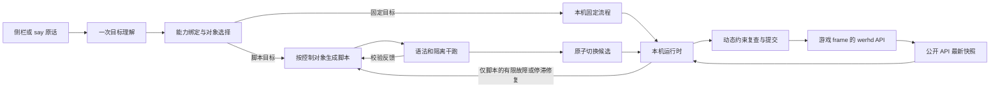

# 当前技术架构

ra2commander 是通过 ra2web 公开玩家 API 运行的本机指挥伴随程序。当前以文本模拟语音，使用 TypeScript / Node.js、Playwright Chromium、独立 QuickJS WASM 子进程和可取消的云模型请求。模型适配与编译流程由项目代码实现，未接入 Pi、LangGraph 或其他 Agent Core。

截至 2026-10-30，工作台、命令侧栏、对局反馈，以及探路、维修车和掩护三个游戏 Skill 已实现。基础攻击、守卫、常规单位部署等已接入本机执行，支持出厂集结、战损转换和进攻时自动碾压；真实录音/识别尚未开始。本轮[架构整理](../roadmap/architecture-consolidation.md)收拢职责与通用事实，具体批准及验收边界见 [AGENTS.md](../../AGENTS.md)。

历史方案和候选选型保留在 `doc/roadmap/` 与 `doc/decisions/`，本页描述当前实现。产品目标见[需求](../spec/requirements.md)，公开 API 调查见[游戏接入](game-api.md)。

## 运行入口与工作台

`pnpm companion` 启动本机 HTTPS 服务，连接常驻 Chromium 并打开 `/commander/`。游戏在同源 iframe 中运行，右侧为命令与反馈侧栏。启动时构建 UI，重连只更新侧栏模块和样式，不刷新游戏 iframe；收起侧栏后游戏占满工作台。顶部品牌及底部状态栏固定，指挥记录、历史对战、设置横排切换；后两页目前仅占位。规则查询、快照和动作都明确绑定游戏 frame。

浏览器 profile、资源和当前游戏保持常驻。普通 `quit` 只断连，`quit hard` 才关闭浏览器。新对局/重连自动使用当前单图配置的冰天雪地分区，不根据地图尺寸猜测地图名称。

输入可来自侧栏、终端 `say` 和 TCP 命令通道，使用相同的基础能力分派器。真实音频接入留在[语音计划](../roadmap/browser-workbench-and-voice.md)的后续阶段。详细操作和调试参数见[运行时行为](runtime-control.md)。

## 命令与执行两个循环

模型通常先理解整句话一次，再为需要变更脚本的全局和编队各编译一次。一个控制对象的多个目标合编，同一条命令中需要编译的对象按序生成；多条命令独立并行理解，普通绑定按收到次序，脚本生成不占用绑定队列，停止/暂停与取消优先。校验重试、重新绑定和自动修复另计。新建筑操作、采矿、搬迁、基础攻击、持续守卫及单位部署通常只需一次理解，直接能力调用无需模型；其余脚本生效后在本机持续执行，不逐 tick 调用模型。

RTS 优先及时行动：同类名称、阵营或实现细节有多个合理候选时结合当前战况选择并反馈；某部分绑定失败时先推进其他可执行目标。正常改令期间旧脚本继续，候选通过后切换；停止、取消和换局立即使旧请求失效。见 [ADR 007](../decisions/007-action-first-command-interpretation.md)。

## 控制对象、目标与事实

每个编队和全局各有独立控制对象，全部编队平级；需要生成代码的目标在对应对象内共用一份脚本，见 [ADR 006](../decisions/006-script-per-control-owner.md)。全局处理生产、建筑、组织与未编队成员；编队脚本控制自己实际接管的成员。同句同队连续移动合为有序路线，后续整句改令替换该队目标；新的全局目标通常追加，取消只撤销对应目标。

| 结构 | 含义 |
| --- | --- |
| `GoalState.spec` | 最新要求，可能正在等待新代码 |
| `GoalState.activeSpec` | 当前执行器已接受的要求 |
| `GoalSpec.executionMode` | `native` 固定流程或 `script` 生成脚本；旧目标默认脚本 |
| `GoalState.facts` | 产物、路线、损失、组装、采矿、搬迁或发射等实际进度 |
| `ProgramState` | 控制对象、修订/运行代次、脚本版本、局部 memory 和状态 |
| `ProductionRecord` | 预留、提交、不确定结果、实际观察到的产物身份 |
| `ScriptAction` | `{goalId, request}`，由目标约束和来源快照共同校验 |

换代码清空脚本局部 memory，保留目标与实际进度。`GoalFacts<K>` 标明各类进度字段归属；完成使用目标状态和实际观察，旧 `done` 字段读取时忽略。移动、路线与集结共用 `arrival.ts` 的主体抵达判定，少量掉队不阻塞全队；抵达不等于清空区域。

`runtime/src/goals/` 静态登记 14 类目标，集中维护各类校验、初始化、观察、成员、约束/视图、状态摘要和动作回执。协调器保留对局生命周期、调度、编译切换、归属交接与统一提交；`skill-lifecycle.ts` 衔接 Skill 的准备、取消与完成，`combat-actions.ts` 协调掩护与碾压转换，`production-submission.ts` 管理生产预留、撤销票据及建筑落点/集结冲突。各服务使用明确的事实引用与回调，不直接依赖整个运行时。各类本机动作与脚本动作共用每对象预算和提交方法，原生目标增改不重编其他脚本；代码切换保留这些目标。执行帧、侧栏与归档共用目标投影，一次计算同时生成约束和视图；不跨请求缓存动态投影，每个动作提交前重新检查额度和归属。

`facts.unitOrders` 保存通用发令去重记录与编队主目标，普通攻击、守卫、本机探索和维修不依赖掩护状态；`coverMotion` 保存掩护预测、重聚、追赶与站位。`UnitOrderBook` 从成功回执更新目标记录及进程内的出口让路恢复索引，碾压强移不作为让路后的旧订单重放。普通行军、探索落点和维修待命跟随使用通用移动发令，维修还记录上车及友方目标订单；掩护才使用预测协调。探索与维修本机处理器分别复用原 `ExplorationStore`、`planRepairs` 的动态分配，不重复实现覆盖或伤员选择策略。

`command-intent.ts` 在一次校正中提取分句、编队、地域、兵种提及及敌方选择，组织、部署、基地防守和作战共用。`combat-plan.ts` 集中处理地域、空地、监视和移动/攻击合并，绑定修正共用分句及泛称防空车规则；原话、模型原始解析与修正结果仍分别归档。

`unit-selection.ts` 统一现有成员的名称、角色、ID、归属、可用性与数量。生产候选和待准备成员使用同一目录查询。三个攻击入口共同生成 `objective.target/search/completion`，保留地面搜索和逐机出击的差异。`membership` 区分固定 ID 与指定生产/编队来源，避免无限吸收后来同型成员。见[攻击与飞机出击](../spec/selected-attacks-and-sorties.md)。

## 公平调度与隔离

运行时保留下一控制对象的位置，新快照抢占后继续轮转。每访问 8 个对象让出事件循环，处理停止和页面消息；同一快照中每个对象本轮最多执行一次。只推进最新快照，不重放积压微操。

编译干跑与实战分别使用独立的 `StepExecutor` 和按需启动的 QuickJS 子进程，互不占用串行队列。每步新建 QuickJS runtime/context，跨步只保留 JSON memory；不暴露 Node、页面、文件或网络句柄。默认实战预算 60 ms，编译干跑 200 ms，宿主另有硬超时和进程重建。具体资源限额以 `packages/js-worker/src/` 为准。

宿主检查动作种类、实际成员、地域、目标和累计生产额度，页面桥在真正调用前复查对局与快照。转编先同步归属并锁住交接成员，实际停车提交成功后开放新队指挥。显式攻击由游戏处理接近和开火，不被宿主的射程估算拒绝；区域选敌与行军范围分开。

宿主与页面桥共用 `packages/contracts/src/game-algorithms.ts` 的异形分区、建筑画面方位和碾压适用条件。`bridge-source.ts` 将已擦除类型的自包含工厂与 `bridge.js` 安装函数组成注入脚本，桥版本也在此统一声明；不引入页面模块加载器。共享工厂只用参数和局部值，不引用 Node、模块值或游戏 API。实时取单位、查规则、选址、射程查询、会话复查与提交仍在原边界处理；页面升级保留当局身份而不刷新游戏。

生产在非幂等调用前保存预留检查点。明确未发送才释放额度，不确定提交保留记录；提交成功不当作实际产出。产物按新身份累计，不因阵亡自动重造。同名目标和共享前置复用现有台账。编译与实际运行共用本步队列空位调度，冲突项目顺延。

## Markdown、规则和 Skill

`prompts/templates/` 保存理解、编译与修复契约；`prompts/capabilities/` 的 32 项能力定义生成 TS 参数类型。终端语法、`cap`、侧栏和 `say` 使用同一分派入口，停止/暂停等直接控制无需生成新代码。

`prompts/games/current-mod.md` 选择当前共和国之辉完整目录，角色和别名服务于名称选择，科技树、可造清单、队列、电力和规则以公开 API 为准。通用依赖闭包复用已有和已提交前置。`prompts/tactics/` 按目标及恢复阶段组合，`skills/` 定义探路、维修车和掩护流程。

同一命令在理解和异步准备前捕获一套完整提示版本，编译、校验重试和重新绑定复用它。后续新命令加载 Markdown 修改；重载失败保留上一套完整定义，严格检查命令仍报告磁盘错误。修改文件不热替换运行脚本。

探路由宿主分批观察实际揭开格子、分配动态落点，各狗独立推进，逐区至少 60%。维修车由 IFV 和工程师真实组装，多个成员并行维修不同受损坦克。探路、维修车的已有成员准备及动态发令默认本机执行，新造组件的有限生产也本机执行并共用全局生产台账；无标记旧目标保留原脚本，并可按能力显式回退。掩护由宿主持续协调，双方同属一个编队，按真实规则速度预测行军，补员独立追赶，任一侧耗尽后转普通编队继续原任务。三个 Skill 均保存当局进度和版本，不逐步调用模型。详见[掩护](../spec/cover-skill.md)、[探路](../spec/scouting-skills.md)、[维修车](../spec/repair-vehicle-skill.md)、[游戏目录](../spec/full-game-catalog.md)与[战术层](../spec/game-rules-and-tactics.md)。

## 运行恢复与复盘归档

`.runtime/state.json` 是 v4 运行检查点，当前快照证明同局后才导入，兼容 v3；旧 `coverMotion.orders/focusTargetId` 仅在读取边界转换为通用 `unitOrders`，输入旧检查点不被原地修改。旧 v1/v2 不自动合并。恢复保留台账、归属、交接、Skill 与阶段进度，预留未决提交变为待确认，不自动重放。故障/停滞修复限次，旧版本与新命令之间继续检查取消、对局和运行代次；云端不可用时现有脚本仍可运行。见[自动恢复](../spec/automatic-recovery.md)。

`.runtime/battles/<id>/` 是独立的只读复盘来源。v3 `events.jsonl` 存阶段事件、转写变化、编译引用与观察变化，动态列表按成员身份及字段记录；`objects/` 按 SHA-256 保存提示词、代码、Skill 和静态规格。常规变化合并采样，关键变化保留完整观察，完全相同的上下文不重复写。写入合并，反馈确认前同步正文和事件文件；摘要按两秒窗口更新，脚本正文以文件链接出现，分区边界不在摘要中反复展开。

`transcript.ts`、编译跟踪和 `CommandLog` 共用同一归档；新命令不再另写转写文件。重启只从同局归档恢复卡片与目标关联，不重放命令。旧 v1/v2 日志和 `.runtime/transcripts/` 兼容读取，新写入不批量覆盖历史；损坏末行备份后继续，中间损坏和缺失/变更正文明确报错，未被引用的孤立文件忽略。

侧栏只读当前命令、理解、执行状态、错误和反馈，不加载历史正文或代码。离线 `pnpm records:read` 与现有开发只读接口可以展开完整记录，无需游戏运行；`pnpm records:export` 将新旧归档无损转换为紧凑副本并生成 `.ra2c.jsonl.gz`，按逐事件逻辑哈希验证，保留原档。接收端可直接用读取命令查看压缩包，解包只使用临时目录；归档不进入运行时恢复。见[对局记录规范](../spec/battle-records.md)。

## 验证与后续边界

`pnpm test` 覆盖正常链路、关键故障、基础隔离与数据检查，不访问云模型或真实游戏。实际效果由用户验收；除非明确要求，不截图、录屏、移动镜头或生成额外实机报告。

阶段 5A 的建筑维修/出售已验收，5B 采矿/搬迁已验收。固定实现错误记录供开发修正，不进入云端脚本修复；混合对象的脚本故障仍沿用全局暂停语义。旧状态保留原执行方式。旧目标、显式回退及部分移动保留脚本；新生产、持续补电、显式队列控制、基础攻击、守卫、掩护、单位部署、探索与维修发令由本机执行。职责整理与探路本机化已验收，维修车本机化已提交；生产计划两阶段已于 2026-10-31 通过用户实机验收。补电共用实际供需，队列意图与归属随同局状态恢复；真实语音仍按原计划推进。
