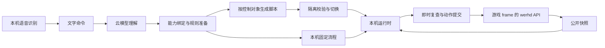

# 技术架构

Electron 承载游戏与侧栏，Node 宿主通过固定页面桥访问 ra2web 的公开玩家 API。浏览器 Companion 是同一套工作台的开发入口；模型编排、执行器与记录由项目代码实现，不依赖外部 Agent Core。

## 职责边界

| 位置 | 职责 |
| --- | --- |
| [apps/desktop/](../../apps/desktop/) | 窗口、单实例、数据目录、内置 Node 宿主与退出、打包 |
| [apps/companion/src/](../../apps/companion/src/) | 命令并发、模型编排、真实对象绑定、规则准备、服务与归档 |
| [apps/companion/ui/](../../apps/companion/ui/) | 三页签、命令与反馈、采音、生命周期和草稿 |
| [packages/command/](../../packages/command/) | Markdown 装配、能力契约、理解/编译、隔离校验 |
| [packages/runtime/](../../packages/runtime/) | 目标、控制对象、归属、调度、生产台账、Skill 与恢复 |
| [packages/game-werhd/](../../packages/game-werhd/) | 页面桥、公开状态与动作映射、资源及首启设置 |
| [packages/js-worker/](../../packages/js-worker/)、[packages/speech/](../../packages/speech/) | 独立 QuickJS 与本地识别子进程 |
| [packages/contracts/](../../packages/contracts/)、[packages/maps/](../../packages/maps/)、[packages/model-providers/](../../packages/model-providers/) | 跨进程契约、地图查询、模型协议 |

## 命令与实时执行

整句通常一次理解，多个独立命令可并行理解、按接收顺序绑定。只有需要脚本的控制对象才生成代码，固定生产、攻击、探路、维修等不生成转发脚本；编译和规则准备不阻塞停止、取消或已有任务。

每个编队和全局管理都是独立控制对象。任务要求、当前生效要求与执行事实分开，生成脚本只替换该对象分配给脚本的部分；换代码清空局部 memory，保留产物、归属与实际进度。普通候选成功后切换，失败保留旧任务；控制命令和换局立即使旧请求失效。

目标处理器在 [runtime/src/goals/](../../packages/runtime/src/goals/) 静态登记。协调器负责生命周期、归属和统一提交，具体目标负责初始化、观察、投影及发令。固定动作和脚本共用预算、即时校验与台账，一个目标只接受一个动作来源。动态投影不跨请求复用，提交前重新检查真实成员、额度与对局。

订单事实由 [unit-orders.ts](../../packages/runtime/src/unit-orders.ts) 统一维护；掩护只增加自己的预测、重聚和近身规则，不承担所有普通行军。生产提交集中在 [production-submission.ts](../../packages/runtime/src/production-submission.ts)，探路复用探索分配器，维修复用伤员与组件规划，避免各入口维护第二套事实。

## 隔离与生命周期

页面 tick 回调只做有限采样，模型、规则批查和原生推理在回调外进行。执行调度轮转并让出事件循环，只推进最新快照，不重放积压微操。QuickJS 校验与实战分进程运行，每步只接收 JSON，不暴露 Node、文件或网络；限额以 worker 实现为准。

页面桥在实际调用前再次检查对局和快照，转编须停车交接成功。几何与通用规则算法由 contracts 共享，桥只注入固定代码，不导入游戏内部对象。普通攻击由引擎接近开火，只有掩护支援保留当前射程限制。

视图请求、订阅和设备随挂载释放，迟到回调不改新视图。重连更新侧栏而不刷新游戏 iframe，保留当前对局和草稿。Electron 关闭先保存并停止宿主，再退出；没有手柄转发层。

## 定义与数据

能力、战术、目录和 Skill 从 Markdown 捕获完整版本，同命令的准备及重试复用，不热替换运行实例。真实科技规则优先于静态目录，固定实现与旧脚本通过相同目标事实共存。

运行检查点与对局归档分离：前者只有证明同局后恢复，后者只供复盘，永不重放命令。详见[运行与恢复](runtime-control.md)、[对局记录](../spec/battle-records.md)；设计取舍见[ADR](../decisions/README.md)，操作命令见 [AGENTS.md](../../AGENTS.md)。
