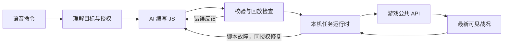

# 架构设计

本轮采用[编队与全局脚本统一替换方案](../roadmap/script-ownership-refactor.md)，决策见 [ADR 006](../decisions/006-script-per-control-owner.md)。

本项目基于 [ra2web](https://github.com/ra2web/ra2web.github.io) 设计独立的本机语音指挥伴随程序。

状态：M1/M2 文本链路与 M3 脚本归属改造已实现并实测；已加入模拟语音转写与地图分区绑定入口。工作台第一阶段已由用户验收通过；第二阶段命令侧栏已实现，等待用户验收，录音识别和 Skill 仍为后续工作。产品行为以[产品需求](../spec/requirements.md)为准，公共接口事实见[API 调查](game-api.md)。

## 系统定位与可行性

ra2commander 是受约束的执行型 Agent，架构由命令编译器与实时任务运行时组成。云端把语音要求编译为任务与行为程序，本机脚本持续观察战况、选择具体动作并根据反馈调整。

现有接口支持这种独立集成方式。生成微操是否有效、规模性能和追击纠正效果仍需原型测量；可行性结论不代表已证明执行效率优于普通群体命令。

项目基于 [ra2web](https://github.com/ra2web/ra2web.github.io) 的游戏公共 API 接入，独立构建和运行，通过浏览器连接配置的 ra2web 游戏页面。上游仓库提供 API、示例和兼容测试参考，不作为 npm 依赖，也不导入其内部类或复制游戏资源。

## 主体程序与组件复用

主体程序使用 TypeScript / Node.js，自行实现游戏任务运行时，复用模型接入、Agent 工具循环、浏览器控制、JS 执行器和本地语音等组件。命令编译部分借鉴 Coding Agent 的“读取上下文、编写代码、校验、根据反馈修复”流程。

| 部分 | 实现方式 | 边界 |
| --- | --- | --- |
| 游戏任务运行时 | 自行实现 | 持续驱动脚本，管理编队归属、授权、版本切换、取消、故障隔离及动作记录 |
| 命令编译 Agent | 优先评估成熟 Agent Core | 在玩家目标内生成和修复 JS，使用查询与校验工具 |
| 基础设施 | 复用成熟组件 | 模型适配、浏览器桥接、JS 执行、语音识别通过独立接口接入 |

### 命令编译循环

1. 收集原始转写、公共 API 契约、可见战况、地图 Profile 和已确认 Skill。
2. 解析对象、目标和授权条件，结合当前战况选择合理解释并绑定当前对局与编队；多个候选不触发默认澄清，简短反馈实际选择。
3. 将命令合并到对应控制对象的待生效目标集合，为完整集合生成新 JS，调用语法、契约与隔离干跑检查。
4. 将错误和失败场景反馈给模型，在限定次数内修复；通过检查后交付运行时。普通改令失败时保留旧任务，停止或禁止类命令先撤权。

编译 Agent 的工具以资料查询、Skill 查询、候选脚本校验和回放为主，实际游戏动作由运行时提交。脚本故障时，错误、相关快照和原授权用于修复；修复不能改变原任务目标或扩大权限。校验通过仍需在真实游戏中观察执行效果。

### Agent 组件候选

优先评估 Pi 的模型适配库与 Agent Core。官方文档提供多模型接口、工具执行、上下文管理、事件流和取消能力，可用于命令生成与修复。参见 [Pi 模型接口](https://github.com/earendil-works/pi/blob/main/packages/ai/README.md)和 [Agent Core](https://github.com/earendil-works/pi/blob/main/packages/agent/README.md)。

LangGraph 支持组合固定步骤与模型步骤，可作为命令编译工作流的备选。首版编译链路较短，当前优先评估轻量 Agent Core；逐 tick 的游戏控制由专用任务运行时负责。参见 [LangGraph 官方说明](https://docs.langchain.com/oss/javascript/langgraph/overview)。

上述组件仍是候选，尚未确定依赖和版本。模型适配与命令编译通过项目自定义接口连接运行时，游戏任务状态、编队归属和授权记录由项目维护。是否保留候选组件，依据单编队原型的生成质量、延迟、取消行为、模型切换和接入成本决定；具体评估步骤见[实施计划](../roadmap/implementation-plan.md#首个原型与组件评估)。

## 技术方案

| 部分 | 首版方案 | 说明 |
| --- | --- | --- |
| 主程序 | TypeScript / Node.js | 编排、任务管理、权限校验、模型和语音适配 |
| 命令编译 | 优先评估 Pi 模型接口与 Agent Core | 生成、校验与修复；具体依赖和版本由原型确定 |
| 浏览器 | Playwright 管理可见 Chromium | 专用用户档案；固定页面桥访问 `window.werhd` |
| 命令脚本 | JavaScript | 每编队一份、全局一份，整体替换；修复保持目标与执行事实 |
| JS 执行器 | 独立 Node 子进程中的 QuickJS WASM | 使用 quickjs-emscripten；不向脚本暴露文件、网络、Node 或浏览器句柄 |
| 本地语音 | 优先验证 whisper.cpp 常驻服务与多语言模型 | 保留 sherpa-onnx / SenseVoice 适配，模型规模以实测选择 |
| 玩家界面 | 轻量本机界面 | 录音、任务反馈和巡视；诊断信息单独展示 |

浏览器桥使用 `addInitScript` 注入、`exposeBinding` 回传快照、`evaluate` 提交有限动作批次。使用独立用户档案，实际游戏加载与开销纳入原型验证。参见 [Playwright 页面求值](https://playwright.dev/docs/evaluating)、[页面 API](https://playwright.dev/docs/api/class-page)与[独立用户档案](https://playwright.dev/docs/api/class-browsertype#browser-type-launch-persistent-context)。

工作台位于 `/commander/`，由现有 HTTPS 服务托管，游戏继续在同源根路径加载到 `ra2c-game` iframe。轻量 TypeScript/CSS 界面启动时构建，侧栏布局更新不重建 iframe；游戏的全屏请求转交整个工作台。`WerhdBridge` 明确绑定游戏 frame，规则查询和动作提交都在该 frame 求值，回传快照同时核对来源 frame。重启复用已有工作台；活动旧版独立游戏页保留原样，不自动迁移。第一阶段仅通过小型只读接口更新连接状态，命令事件及录音按[分阶段计划](../roadmap/browser-workbench-and-voice.md)后续接入。

QuickJS 的内存、栈和执行期限限制用于控制脚本资源，它们不等同于完整操作系统沙箱；默认 `qjs` CLI 不直接作为隔离执行器。当前子进程清空继承环境变量，每步新建 QuickJS runtime/context，仅传输 JSON；脚本不能接触 Node 子进程本身。参见 [QuickJS 文档](https://bellard.org/quickjs/quickjs.html)。

本地识别采用独立线程或进程，避免阻塞控制循环，使用中文和游戏术语样本选模型。参见 [whisper.cpp](https://github.com/ggml-org/whisper.cpp)、[本机 server](https://github.com/ggml-org/whisper.cpp/tree/master/examples/server)、[sherpa-onnx 原生 Node 示例](https://github.com/k2-fsa/sherpa-onnx/blob/master/nodejs-addon-examples/README.md)与[SenseVoice](https://k2-fsa.github.io/sherpa/onnx/sense-voice/index.html)。

## 模块与数据流



图中语音命令先经过本地识别；运行时经动作授权与版本检查、固定浏览器桥调用游戏公共 API。校验失败的候选脚本回到编译循环，健康任务继续运行。

命令编译与本机执行是两个独立循环。云模型在新命令或同授权修复时参与，本机按最新快照持续驱动各编队脚本和一份全局脚本，编队与已授权生产并行。

例如“守桥，战损超过六成回撤修理”：AI 编写选敌、火力分配、站位及条件回撤逻辑；运行时保存原始成员、守区和授权条件，检查提交动作并记录效果。战术算法由 AI 编写，宿主管理执行边界和任务生命周期。

| 模块 | 职责 |
| --- | --- |
| 命令编译 | 结合原话、地图与对象上下文选择合理解释，生成任务条件和全新 JS，优先推进可执行目标 |
| 模型适配 | 处理各云服务的认证、生成、错误、取消和上下文差异 |
| 任务运行时 | 管理任务、成员归属、权限、版本、调度和故障恢复 |
| JS 执行器 | 在资源限制内执行脚本，隔离每份脚本的局部状态 |
| 游戏适配器 | 采集公共状态、映射底层动作、维护规则目录与效果观察 |
| 语音与界面 | 录音、识别、摘要、阻塞反馈和镜头巡视 |

AI 负责选敌、火力分配、站位、队形和执行时机。宿主提供距离、几何、状态查询与底层动作原语，负责权限、资源、会话和生命周期；不内置替代 AI 微操的战术决策器。

## 控制对象与目标

运行时按 `global` 和 `formation:<编队名>` 保存当前脚本，所有编队平级。全局脚本负责生产、建筑、建队、转编、解散、持续补员和未编队集结；编队脚本只指挥本队。所有对象共用 `ProgramController` 的生成、校验、切换与修复流程，共用现有串行 QuickJS 执行器。

命令、任务目标和脚本版本分开记录。一个全局对象可以有多个生产及管理目标；编队保留一个当前战斗目标。新全局命令追加目标，修改与取消指定稳定目标 ID。目标修订号只随要求改变，正常生产进度推进不使候选失效。连续命令取消旧编译请求，最新候选必须包含全部未取消目标。

目标分别保留待生效参数、已生效参数与执行事实。新代码激活时清空局部 memory，生产提交、产物身份、战损基准和队列归属继续沿用。编队从动态上下文读取成员，补员不需要重编译队内脚本，也不重置当前战损基准。

## 当前执行边界（2026-10-21）

- 主进程使用 Acorn 解析至多 64 KiB 源码，只接受一个同步 `function step(snapshot, memory)` 声明；不执行候选代码。禁用标识符扫描只作早期诊断，隔离由 QuickJS 承担。
- 子进程串行接受任务，启动就绪后才计算各请求的预算。QuickJS 限制为每步默认 60 ms、堆 8 MiB、栈 256 KiB；宿主在预算后另加 100 ms 硬超时并杀死失联进程。子进程 V8 old-space 上限 64 MiB，不代表整个进程 RSS 上限。
- 输入 JSON 至多 1 MiB，传入 memory 至多 64 KiB；沙箱返回 memory 至多 16,384 个 UTF-16 码元，整份输出至多 32,768 个码元，宿主另检查整份输出 128 KiB。每步释放 runtime/context，跨步仅保留 memory，不共享脚本全局变量。
- 每次新命令/修复持有独立请求令牌，绑定对局 UUID；停止、手动暂停、换局及后续改令取消旧请求。结果提交还检查任务对象、脚本版本与运行代次，停止后迟到的修复无法部署。普通改令失败保留原任务。
- 每次只推进最新快照，不堆积旧微操。动作使用来源快照的对局 UUID 和序号，桥不替换为当前会话；页面在真正调用 API 前再检查。紧急 stop 允许同局稍早快照，以免新的采样阻断撤权停车。
- 独立授权默认拒绝：单位实时归属、动作种类、地域、生产项目、累计数量和可操作队列都由宿主检查。取消已投入生产的动作始终拒绝；队列状态不可观测时拒绝操作，恢复仅限本任务实际暂停的队列。生产额度在提交前保留；仅对确定未发送的拒绝退款，断连或 API 异常等不确定结果保留额度。自动修复及 v3 同局恢复沿用目标额度、战损身份与已触发回撤阶段。生产预留保存成功后才发送；未决记录不自动重放。
- 战损按任务生效时存活的原始成员计算，宿主追踪已知转换形态的邻近新身份；近邻匹配仍受公共 API 缺少转换事件的限制。严格超过阈值才开放已绑定回撤点，触发后只能前往该点或停止。原生追击导致越区时，宿主停车并纠正到最近区内格，偏移仍受快照采样周期影响。
- 显式攻击不做宿主或页面桥的射程前置拦截，接近、寻路与开火由游戏处理。区域清敌按真实分区边界筛选敌人，行军范围与选敌范围分离；目标消失、队员阵亡或离队时跳过过期动作，不把正常战场变化累积成脚本故障。

当前文本 CLI 保留显式参数入口，并增加 `say` 模拟语音转写入口。`transcript.ts` 先把原话、当前阵营规则目录、编队和已绑定地名发送给模型，得到结构化操作；宿主将其绑定为目标，再由 `ProgramController` 为完整目标集合生成 JS。语音操作区分现有单位编队、生产并编队、移动、区域清敌和全图进攻；明确编队及地名不能在绑定时扩大范围。模型原始解释单独保留，侧栏摘要由实际绑定计划生成。两个阶段的提示分别位于 `transcript.ts` 与 `script-contract.ts`。录音识别、任意条件解析和语音澄清尚未实现，操作方式见 [AGENTS.md](../../AGENTS.md)。

2026-10-22 起按 [ADR 007](../decisions/007-action-first-command-interpretation.md) 优先快速反应：目录同时标明当前可生产项目，普通生产名称按可生产性、当前阵营和已有设施选择；同名或同类有多个候选时直接选取。模型选到本局不可用的另一阵营同类名称时，绑定到本局可用项目；多辆基地车优先选空闲车辆。同一句话的对象绑定失败仅跳过该项，其余目标继续进入脚本生成。选择在命令响应中简短反馈，不增加确认或二次模型询问。

当前单图配置默认使用冰天雪地，新对局和重连时自动绑定其分区，`map use ice` 保留为手动重绑入口；不根据地图尺寸猜测地图。前往地名使用分区内部的整数候选格，沿途活动范围包含行军路径；实际可达性由后续位置确认，不把分区标签当作已知可达点。生产目标可关联目标编队，只有本目标累计观察到的新产物可被编入该队，归属变更仍经过停车交接。明确的持续补电目标按实时耗电、待完成建设耗电与在建电厂计算剩余生产量，保持已有预留和提交记录。

命令侧栏复用运行时的目标事实：实际产出或展开转换确认有限目标完成，移动目标等全部存活成员进入目的地附近后完成，持续补电、守区保持持续执行。目标完成后不再运行该目标；脚本所有目标完成时进入 idle。宿主在既有快照处理后比对精简状态，只有变化才经 SSE 推送；一条命令按各目标汇总，不能由某项成功推断整条完成。重启从已有转写文件与同局运行时目标恢复卡片，不重新执行历史命令。

`pnpm test` 检查正常命令链路、关键故障、基础隔离和地图数据；`pnpm scenario:voice` 单独执行访问云模型及真实游戏的六句验收。原型阶段不对实验中的授权策略逐项固定断言；真实引擎效果和规模性能需继续实测。

## 命令记录与脚本契约

以下结构是伴随程序的自定义契约，不是游戏原生 API：

| 记录 | 保存内容 |
| --- | --- |
| GoalState | 控制对象、稳定目标 ID、原话、待生效与已生效要求、独立执行事实 |
| ProgramState | 控制对象、目标修订号、当前代码版本与源码摘要、局部 memory、运行状态 |
| ProductionRecord | 来源目标、预留或提交数量、结果状态、累计观察到的产物身份 |
| Snapshot | 对局代次、tick、序号、己方和可见单位、已揭示地形、资源和生产状态 |
| ScriptAction | 来源目标 ID 与游戏动作或宿主编队管理请求；提交绑定代码版本和快照 |

候选脚本入口是 `step(snapshot, memory) → { actions, memory }`，动作形如 `{ goalId, request }`。`snapshot.control` 提供控制对象、完整有效目标、实时成员、剩余产量和已观察进度。脚本通过快照返回有限动作和下一份局部状态，所有动作进入统一检查。它不能持有页面、文件或网络句柄，也不能自行增设战略任务。

任务目标与授权独立于代码版本保存。修复保持同一份权限，换目标或修改条件建立新命令。命令按合理解释执行并显示简短摘要，不因对象、地点或执行细节存在多个候选默认等待澄清。权限检查不能证明自然语言理解永远正确，接受语义误解，并允许玩家用后续命令纠正。

## 调度、授权与改令

所有任务共享一个页面 tick 入口。快照使用有界缓冲和最新状态替换，动作携带对局、任务、版本与快照时刻；拒绝迟到、过期或失效批次，不重放堆积的旧微操。

提交前复查单位存活与归属、目标可见性、授权地域、条件和生产状态。每个单位只有一个执行编队；转编同步更新归属并锁定交接单位，使旧结果失效，停止提交成功后再开放新队指挥。管理动作在宿主处理，不增加页面编队 API。节流合并相同订单，但保留重新选敌和纠正引擎偏移所需的发令。

普通改令先编译、校验和绑定新脚本，就绪后原子切换任务版本，等待期间旧任务继续。停止或禁止类先撤销相关旧权限，取消单个全局目标时丢弃该目标动作，其余目标继续；可在本机识别少量明确取消语句，复杂限制仍需语义理解。已经提交给游戏的订单还需要可用的停止或纠正动作，版本失效本身无法撤回它们。

宿主可为撤权、越界纠正和失效订单发出必要控制动作；新目标选择与战术调整由 AI 逻辑决定。原生追击的监控、纠正和度量见 [ADR 005](../decisions/005-correct-engine-pursuit-through-public-api.md)。

## 并行生产与规则目录

一份全局脚本协调全部生产与管理目标，各编队脚本独立调度。固定程序维护按目标的提交记录、归属和前置去重，AI 编写执行步骤；必要前置以固定支持 MOD 的目录及 `rules()`、`production.available()` 复核。目录不承担任意 MOD 的自动科技树发现。

生产优先级只操作允许的提交顺序与类别暂停。记录按目标保存暂停队列，取消时仅清理该目标实际暂停且仍归它管理的队列。共享资金机制和已入队项目限制见 [API 调查](game-api.md)。

## Skill 与地图数据

Skill 保存名称、参数、实现、版本、所需 API、适用游戏/MOD/地图范围和验证样本。候选经回放与实际场景验证、开发者确认后入库；运行时只加载登记版本。命令记录引用的 Skill 版本，代码跨局复用，单位、进度和权限按任务隔离。

地图 Profile 保存经校准的地图版本、坐标与方位约定、大区和小区边界、名称及别名。启动流程选用 Profile，不根据公共 API 假定能自动识别地图；静态地理数据不包含实时隐藏敌情。

现已提供 `packages/maps` 的方案读取、校验、空间查询，以及 `maps/ice/schemes/` 的 17 区数据。方案将地图哈希与方案版本分别保存，边界使用原生 `rx/ry` 多边形；[分区规范](../spec/map-regions.md)记录生成方法与静态校准结果。地名解析和多边形守区尚未接入命令、运行时及页面桥。

## 故障与连接恢复

每个脚本分别限制时间、内存和发令量。编队异常只暂停本队并尝试停止其单位，全局异常暂停后续生产与管理；已提交游戏的生产可能继续，其他编队继续。修复版重新校验和试运行。重试有上限，连续失败后保持暂停并反馈，不改变战略目标。

云端不可用时，现有本机脚本继续，新命令或修复显示等待/失败。页面桥或调度进程失联时标记控制丢失，旧动作版本失效；恢复后先重建会话与观测，确认任务和对象仍属于当前对局再恢复。旧局任务不得重新作用于新局，失联期间无法保证撤回游戏已收到的订单。

v3 状态在当前快照确认同局后恢复；v1/v2 不自动合并，首次写 v3 前保留旧格式备份。普通跨步保存局部 memory，换代码时重新建立 memory。生产预留通过原子 JSON 检查点落盘，恢复未决提交标为 unknown，人工核对可用 `goal resolve` 标记是否已发送。页面刷新换局仍不支持恢复，无法证明生产结果时保持待确认。

产量按新观察到的单位 ID 累计，不以存活净增量代替生产完成。同名目标串行等待已有提交的观察结果，共享前置复用已有或已提交建设；缺少可靠出生事件时仍有归因限制，不能把推断称为引擎回执。

## 代码结构与后续模块

```text
ra2commander/
  README.md                 # 项目介绍、ra2web 来源与文档入口
  AGENTS.md                 # 项目约定、环境搭建与构建运行说明
  doc/                      # 设计规范、决策、架构与路线图
  apps/companion/            # 启动、录音、任务反馈与巡视
  packages/contracts/       # 命令、快照、动作与适配器类型
  packages/command/         # 命令编译与同授权修复
  packages/runtime/         # 任务、成员、权限、版本与调度
  packages/js-worker/       # 独立 QuickJS 进程
  packages/game-werhd/      # 页面桥、公共 API 映射与规则目录
  packages/speech/          # 本地识别适配
  packages/model-providers/ # 云服务适配
  packages/maps/            # 分区方案读取、校验与离线提取
  maps/ice/                 # 校准后的冰天雪地地域数据
  skills/                   # 已确认能力与验证样本
```

以上同时包含已实现模块与后续规划；当前目录与运行命令见仓库 AGENTS.md。原型步骤与性能测量见[实施与验证计划](../roadmap/implementation-plan.md)。
