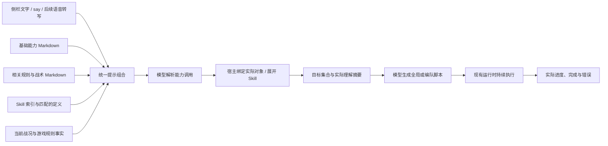

# 基础能力、游戏规则与 Skill 的统一接入改造方案

状态：A、B 已经用户验收，用户批准提交 B 后开始阶段 C。C 已获准开始，D 未开始；现有工作台阶段 2 的验收状态不变，本方案不自动启动真实语音阶段。

## 目标与建议

保留用户提出的三层：基础操作、游戏规则与战术约定、常规操作 Skill。全部固定提示词保存为 Markdown，Node 通过统一加载器读取、组合。能力定义同时用于模型说明、参数校验与宿主绑定，解决“终端已有能力、自然语言却没有接通”的遗漏。

三层是内容组织方式，普通命令继续使用“解析目标 → 生成所属控制对象脚本”的现有链路，不为每层增加一次云模型调用。继续保持每个编队一份脚本、全局一份脚本；Skill 复用它们，不另设一套竞争单位控制权的脚本。

建议把第二层正式命名为“游戏规则与战术约定”。电厂、矿场等建造前置属于当前游戏/MOD 的规则事实；集火、接敌、巡路、队列协调等才属于执行约定。两者可共同向模型说明，但规则计算保留在现有宿主实现中。

## 当前实现与改造范围

| 当前实现 | 现状 | 本次改造方向 |
| --- | --- | --- |
| `transcript.ts` | 组合当前事实、解析能力调用，记录原始结果及实际请求版本 | 已接共用能力目录与分派器 |
| `transcript-plan.ts` | 使用 Markdown 生成的调用类型，保留两类已修复误解析纠正 | 不再手工维护独立 Operation 枚举，不新增按句子特判 |
| `script-contract.ts` | 代码提取与语法校验；生成提示已外置 | 提取与校验继续留在 TS |
| `compile.ts` | 生成、修复和校验流程；固定反馈提示已外置 | 运行时只注入结构化事实与诊断 |
| `prompt-loader.ts` | 原子加载模板与能力目录、检查参数契约、缓存及错误回退 | C 再组合相关战术主题 |
| `commands.ts` | 原有玩家语法及通用 cap 入口均接共用分派器 | 调试和环境操作继续独立 |
| `prepare-goals.ts`、`production.ts` | 已查询规则、计算前置、队列和额度 | 继续复用，整理为规则事实提供接口，不让模型重算科技树 |
| `packages/runtime` | 已有目标、脚本版本、归属和完成事实 | 维持调度；Skill 阶段再补目标依赖、探索事实和来源关联 |
| `skills/` | 尚无运行实现 | 先落地一个“探路”Skill，验证组合、完成、取消和恢复 |

本方案覆盖命令能力与提示组织，不包含麦克风、ASR、Electron、通用插件平台或任意 MOD 的自动规则发现。

## 三层内容的责任

| 层 | 保存什么 | 模型如何使用 | 宿主负责什么 |
| --- | --- | --- | --- |
| 1 基础操作 | 操作名称、参数、对象选择方式、效果、示例、反馈约定 | 将自然语言转换为已有能力调用，生成落实目标的脚本 | 解析参数，绑定实际单位/编队/地图，提交动作与维护状态 |
| 2 游戏规则与战术约定 | 如何使用规则查询结果，生产顺序、选敌与行动原则、游戏/MOD 适用说明 | 在当前事实下安排合理执行，暂时受阻时推进其他部分 | 查询真实前置、可造项目、队列与电力，提供确定事实和计算结果 |
| 3 常规操作 Skill | 名称、版本、默认参数、基础能力组合、阶段交接、结束与中止条件 | 识别玩家要执行的常规操作，结合参数生成对应执行逻辑 | 展开已登记步骤，跟踪真实进度，将目标送入现有全局/编队脚本 |

补充说明：

- 第一层需要同时说明玩家操作与游戏动作的关系。例如“编入现有坦克”是玩家能力，底层由创建/转入编队实现；无需玩家提供单位 ID。不能直接拿原生 API 名称列表充当完整的自然语言能力目录。
- “建设战车工厂”会查询当前规则并补齐真正缺少的前置，已有或正在建设的前置复用。不能把“电厂 → 矿场 → 重工”的文字示例写成所有阵营和 MOD 都适用的固定事实。
- 战术约定可以指导选敌和执行顺序，不凭一条通用建议额外建立生产或扩张目标。Skill 则可明确包含自己的默认生产步骤，例如探路默认新造三条狗。
- Skill 是可以带版本复用的行动配方，也可以附示例代码帮助生成。初版仍由模型生成微操；不把自然语言系统改成只能挑选固定手写战术的系统。

## 第一层：统一能力定义

### 每个能力只声明一次

每个玩家能力使用一个 Markdown 文件。文件内有一个约定的结构化元信息块，其余正文保存识别、执行和反馈说明。元信息可使用固定标记的 JSON 代码块，首版无需为配置额外引入 YAML 语法。

元信息包含：

| 字段 | 用途 |
| --- | --- |
| ID、名称、版本 | 稳定引用与展示，如 `formation.assign` |
| 参数定义 | 类型、必填项、枚举与默认值；是该能力参数的唯一声明来源 |
| 对象选择方式 | 接受哪些单位/编队/地域描述，选择发生在接令时还是执行期间 |
| 绑定器 ID | 引用 TS 中已登记的绑定实现，不在 MD 中任意导入代码 |
| 控制对象 | 全局管理或指定编队 |
| 说明与示例 | 模型何时使用这项能力，和相近操作有什么区别 |
| 反馈约定 | 理解摘要、进度、完成及部分执行如何呈现 |

例如 `formation.assign.md` 描述“把现有单位编入队伍”，声明数量/全部、单位选择器与目标编队；正文写清优先现有未编队单位、已在目标队内的不重复转入、不能把不足数量自动转为生产。

加载器从同一份元信息生成模型可见参数说明并校验模型调用；构建步骤从该定义生成 TS 参数类型，不能继续手工维护一份独立 `Operation` 枚举和另一份不一致的参数协议。底层 `GoalSpec`、动作契约仍由 TS 定义，绑定器负责两者间的转换。

绑定实现、单位/地图选择器与实际游戏调用继续放在 TS；修改一段 MD 说明不会凭空实现游戏新功能。新增真实能力需要同时登记绑定器，加载检查会发现有说明无实现、有实现却未声明入口的遗漏。

### 首批完整接通的玩家能力

| 类别 | 首批范围 |
| --- | --- |
| 基地与生产 | 展开基地、目录内单位/建筑生产、生产后编队、持续补电 |
| 编队组织 | 现有单位编入、转编、解散；扩展现有坦克选择器到已支持的步兵/车辆等类别 |
| 作战 | 移动、守区、区域清敌、指定队或全体作战队进攻 |
| 持续管理 | 补员、未编队单位集结 |
| 生命周期 | 停止、暂停、恢复、取消目标、修改生产目标数量；明确作用于编队、全局还是一个目标 |

按当前底层实际能力逐项列出“已实现、已声明、已接自然语言、已验证”。终端、侧栏和未来语音共用玩家能力分派入口；终端参数解析仍可使用原有语法。`eval`、截图、资源导入等调试/环境操作不混入玩家命令能力目录。

单个兵种不单独增加一种操作。生产和对象选择通过当前游戏目录解析兵种、建筑、阵营与角色；新增一种可生产单位，通常补目录与角色映射即可。

### 解释与执行同源

模型返回能力 ID 和参数，宿主绑定后再生成主卡片摘要。模型原始解释继续保存用于开发检查，但不独立决定卡片展示的实际行动。数量、生产/编队语义、目标编队和分区不能在不同环节各解释一遍。

已修复的“编队被误当生产”“区域清敌被拆成全图进攻”保留为故障用例。统一目录后不再扩展按中文句子的正则表；楼层数字、编队别名等通用规范化可以保留，操作语义归回能力定义与绑定器。

## 第二层：规则事实与战术约定

规则事实的来源优先级：当前引擎返回的规则/可造状态与实际观测，其次是对应游戏/MOD 的目录资料。MD 说明如何理解它们，不保存另一套相互竞争的实时事实。

例如玩家要求建重工时：

1. 解析当前阵营对应的生产项目。
2. 复用现有前置闭包计算，查询当前缺少什么；复用已有和已提交的必要前置。
3. 给模型缺少前置、队列空位、已提交数量等精简事实，而不是让模型凭常识重新猜。
4. 全局脚本按当前可执行项目推进；部分受阻不阻断其他目标。

生产目录与角色映射应从 `PRODUCTION_FAMILIES`、坦克名称匹配等分散代码中整理出来。首版覆盖当前游戏/MOD，能根据阵营、可造清单和规则选择“侦察犬”等角色；不承诺自动认识任意 MOD。

战术文本按主题保存，例如接敌、选敌、生产协调、异常恢复。只加载本次目标需要的主题。普通攻击继续交给游戏处理接近与开火，不能借规则层恢复已移除的射程拒绝。

## 第三层：常规操作 Skill

### 一个 Skill 的内容

首版每个 Skill 一个目录、一个 `SKILL.md`，结构化部分声明 ID、版本、名称/别名、适用游戏、默认参数、所需基础能力和少量步骤依赖；正文说明行为、阶段交接和完成条件。

首版只支持基础能力组合与实际结果依赖，不引入通用工作流语言。可选的示例代码作为模型参考，不直接在宿主执行 Skill 中任意附带的 JS。

修改常规步骤、默认数量或战术说明主要编辑 MD；新增底层动作、观测能力或目标状态仍需 TS 实现。开发者检查后将 Skill 登记入库，玩家在对局中调用它不再逐步确认。

### “探路”的首版定义

默认行为按用户给出的含义确定：新生产三条狗，组建专用侦察编队，按当前地图分区探索。玩家说“用五条狗探路”时覆盖默认数量；说“用已有狗探路”时选择现有单位，不再生产。

| 阶段 | 行为 | 推进依据 |
| --- | --- | --- |
| 准备 | 选择本局可用的侦察犬，建立三只的生产及编队目标，必要前置沿用规则计算 | 实际产出身份与归属确认；已可调动的成员可先开始探路，剩余成员到齐再加入 |
| 巡路 | 按分区组织路线，将探索区域分给侦察成员，选择区内尚未探索的候选格 | 实际位置、已探索范围和路线进度；不等待每个路点的云回答 |
| 调整 | 遇到阻塞尝试其他候选点，跳过暂时不可达点；记录仍未覆盖部分 | 位置推进与停滞、当前地图信息；不能假定所有分区都能由狗抵达 |
| 结束 | 可达且可观测的探索范围已满足，结束移动任务 | 实际覆盖事实；存在无法覆盖部分时显示部分完成及原因 |

这项 Skill 还需要新增 `map.explore` 基础能力。当前只有移动与区域清敌，没有地图探索目标与覆盖进度，因此把“探路”写进 MD 本身还不能完成该功能。

“依次去各分区中心”只能作为初始路线，不能等同于把地图视野探开。需要区内多个探索点，并区分“曾经揭示过”与“当前可见”。现有 API 类型声明包含 `map.tile()`、`map.visible()`，实施时先核对其实际语义，再决定如何累计已探索信息。以 API 能确认的覆盖范围验收，不凭三条狗经过某处就宣布全图已探索。

地图探索观测采用分批读取、缓存和增量更新，不逐帧遍历整图，也不向模型/侧栏传输整张地图格子 JSON。无需截图、移动镜头或录屏来判断进度。

探路不会自行追加无限补狗、扩军或转为全图进攻。部分狗阵亡时，其余成员继续；全部阵亡或无法继续时显示失败/部分完成。只有 Skill 或玩家明确要求补员时才增加后续生产。

### 与现有脚本和状态的关系

Skill 步骤展开成现有目标；生产、建设和编队组织进入全局脚本，巡路进入专用编队脚本。新增一个轻量协调模块，根据实际目标结果建立后续目标，不直接微操，不另起一份控制同一队的脚本。

步骤依赖使用明确的实际里程碑，例如“首个可指挥成员已经完成交接”或“生产目标已完成”。不能只凭 API 调用成功、编队名称出现就认为已可执行下一步；也不必让可用的第一条狗等待全部成员到齐。首版只实现这些已明确需要的里程碑，不支持任意条件表达式。

Skill 每次调用记录稳定的运行 ID，并关联命令 ID、Skill ID/版本、展开的目标 ID、所用编队、地图分区版本和完成/阻塞状态。探索进度、已提交数量等实际事实独立保存，脚本整体替换或故障修复不能重置这些进度。现有局部 `memory` 只保存短期执行记忆。

取消 Skill 会停止其后续步骤及相关未完成目标，其他全局目标继续。对侦察队改令会结束该队原探索任务，旧 Skill 不应随后重新接管。已投入游戏的生产不因记录恢复而重放；取消 Skill 不默认撤回已投入生产的队列。

首版状态扩展需包含 Skill 与探索事实，实施时明确持久化兼容版本。旧 v3 目标和生产记录不能直接丢弃或当作新任务重播，优先提供无 Skill 数据的兼容读入。

## Markdown 文件与代码组织

建议结构如下，实施时按阶段创建，暂不提前建立空目录：

```text
prompts/
  templates/
    interpret.md                # 自然语言解析的输出与角色约定
    compile.md                  # 编队与全局共用的脚本生成模板；确需分化时再拆
    repair.md                    # 故障修复模板
    validation-feedback.md      # 校验失败的修正提示
  capabilities/
    formation.assign.md
    production.produce.md
    combat.clear-region.md
    task.stop.md
    ...
  tactics/
    common.md
    production.md
    combat.md
    exploration.md
  games/
    current-mod.md              # 当前游戏/MOD 目录、角色与规则适用说明
skills/
  scout/
    SKILL.md
apps/companion/src/
  capabilities/                 # 绑定器与选择器，使用当前对局上下文
  skills/                       # 首版 Skill 展开和步骤协调
packages/command/src/
  prompt-loader.ts              # 读取、校验、缓存、组合 Markdown
  ...                           # 现有编译与校验保留
```

`prompts/`、`skills/` 中的 Markdown 是程序读取的运行资产；设计说明、改造计划仍放 `doc/`。

JS/TS 通过统一加载器读取 MD，例如内部使用 `readFileSync(new URL(..., import.meta.url), 'utf8')`。按模块路径定位，不依赖启动时工作目录；打包时一并携带这些资产，无需引入浏览器打包器来支持 `.md`。

所有固定模型指令、修复文本、校验失败反馈模板和示例均迁入 MD。当前战况、实际规则、参数定义和诊断信息仍是动态数据，由加载器注入模板；界面文案、代码错误消息和校验逻辑不因此全部搬成提示词。

模板只使用限定变量，不在 MD 中执行 JavaScript。文件内容按版本/哈希缓存，重读发生在新命令或显式开发重载时，不发生在逐 tick 执行中。同一命令固定使用同一套提示与 Skill 版本；修改 MD 不自动刷新游戏、重播命令或改变正在执行的目标。

加载过程校验参数格式、能力 ID、绑定器引用、Skill 依赖和模板变量。只向模型声明已经可用的能力；开发重载失败时保留上一套可用定义并反馈具体文件错误，不使已有对局停下。

## 提示组合与调用链路



解析阶段提供玩家能力目录与简短 Skill 索引。明确调用“探路”等 Skill 时展开对应定义；脚本生成阶段按控制对象和目标类别加入相关战术文本及被调用的 Skill 内容，不把全部 Skill 正文附加到每次请求。

首版通过名称、别名和简短说明选择 Skill，不引入向量检索服务。Skill 的默认流程由登记步骤展开，沿用当前脚本生成流程；不为每个阶段、分区或路点新增一次模型调用。新语音模块只负责录音和识别，识别文字继续进入同一条能力链路。

玩家本次明确参数覆盖 Skill 默认值；当前实际游戏规则用于判定如何执行。一般战术建议不能改写玩家目标或把明确分区扩大到全图。仍坚持快速行动，能执行的部分先推进，不增加常态确认步骤。

## 分阶段实施与验收

| 阶段 | 交付 | 用户验收重点 | 当前状态 |
| --- | --- | --- | --- |
| A 提示词外置 | 移出所有固定模型指令，建立 MD 加载与请求版本记录，暂不改变操作语义 | 能直接检查/修改 MD；实际请求使用该文件；当前命令行为与侧栏不回退 | 2026-10-25 用户验收通过 |
| B 统一基础能力 | 单一能力定义、参数校验、绑定器分派，接齐现有底层玩家能力，整理单位/地图选择器 | 不再出现终端支持而语音无入口；编队、生产、停止/取消等语义和反馈一致 | 用户验收通过 |
| C 规则与战术拆分 | 建立当前游戏/MOD 目录及角色映射，按需组合战术，复用前置与生产事实 | 建重工自动复用/补齐真实前置；阵营和当前规则变化不靠改多份提示；不恢复射程拦截 | 已获准在提交 B 后开始 |
| D 探路 Skill | Skill 加载、最小步骤依赖、探索能力与观测、取消/改令/恢复，首个 `scout` | “探路”生产三条狗并探索分区；可改数量或用现有狗；实际覆盖、阵亡、不可达与中止状态准确 | 未开始 |

2026-10-24 阶段 A 交付：固定解析、脚本生成、故障修复和校验反馈分别迁入 `prompts/templates/`；两份主提示与修改前内容逐字一致。`prompt-loader.ts` 校验限定变量并按全部文件内容计算 SHA-256 版本，相同内容复用缓存；新命令重读失败时沿用当前进程上一份完整可用定义并输出文件错误。同一条转写命令把同一套模板传给各控制对象编译，`.runtime/transcripts/` 记录理解及各次实际编译请求的版本，编译结果和尝试日志也携带版本。运行中的脚本不热更新。

2026-10-25 阶段 A 复核修正：终端生成与自动修复在异步准备前固定模板，成员变化导致重新绑定时也不切换版本；生效脚本的 `script.promptVersion` 随 v3 状态保存，旧状态继续兼容。加载器按目录独立缓存完整定义，开发重载失败继续使用上一套，默认输出具体文件错误。增加 `pnpm prompts:check [模板目录]` 严格检查磁盘内容，不以缓存回退掩盖错误。转写的理解版本只在实际模型请求前标记。

阶段 A 检查：`pnpm typecheck`、`pnpm prompts:check` 通过；`pnpm test` 55 项全部通过。检查直接比对模型请求与 Markdown 原文，覆盖修复、校验重试、限定变量、错误重载回退、异步准备及重新绑定时的版本固定与状态恢复；未访问云模型或真实对局，实际命令效果仍由用户验收。

2026-10-25 阶段 B 交付：18 项能力分别保存为 Markdown，参数校验、默认值、模型说明与输入/绑定器 TS 类型来自同一份定义；新增能力接线检查和类型生成命令。终端原有语法与通用 `cap`、侧栏、`say` 复用分派器与单位/编队/地图选择器，补齐转编、解散、守区、补员、集结及生命周期入口。目录加入当前可造项目并可查询步兵、飞机规则；完整游戏/MOD 角色和战术拆分仍留在 C。完整能力表见[玩家基础能力](../spec/player-capabilities.md)。

停止、暂停和可直接恢复的操作不再生成脚本；修改总量沿用提交记录与稳定目标，失败时旧目标继续，已完成后追加总量只补增量。无新目标的控制命令保存结束状态并可恢复当前局卡片。守区有独立模式，抵达就位点后持续，不被移动的到达判断提前完成。两类既有误解析故障检查保留。

阶段 B 检查：类型、模板、能力接线检查及 62 项自动测试通过，包括现有命令链路、实际成员交接、补员集结、暂停停止、在途取消、增量生产与状态恢复；未请求云模型或操作真实对局。B 等待用户验收，C～D 未开始。

每阶段完成相关检查后交付用户，用户验收通过再继续下一阶段。计划批准后仅开始 A，不一次实施全部阶段；本轮起草文档不代表现有工作台阶段 2 已通过验收。

检查以现有类型检查和故障用例为基础，只补与本次改造直接相关的少量检查：MD 加载/引用有效、能力接线完整、关键命令语义、Skill 取消/恢复不重复生产，以及探索完成不能由路点提交替代。真实效果由用户看游戏与侧栏，不自动截图、录屏或生成测试报告。

## 首版范围与暂缓项

- 先覆盖当前游戏/MOD 与冰天雪地，首个 Skill 只做探路。
- 不新增技能商店、自动下载/安装第三方 Skill、复杂插件机制或通用工作流引擎。
- 不把提示词文件热改直接作用于已在运行的任务。
- 可支持自由自然语言组合基础能力，Skill 负责复用常规流程，不要求所有玩家命令都先制作 Skill。
- 需要新增的探索目标、覆盖观测和跨控制对象步骤依赖在 D 明确实现，不把“MD 已写好”当作功能交付。

阶段 B 已同步 Skill 的领域定义与 ADR 009，明确其由代码复用扩展为“常规行动定义及可选代码参考”；现有 AI 生成微操、每队/全局独立脚本和跨局状态隔离原则继续保留。
