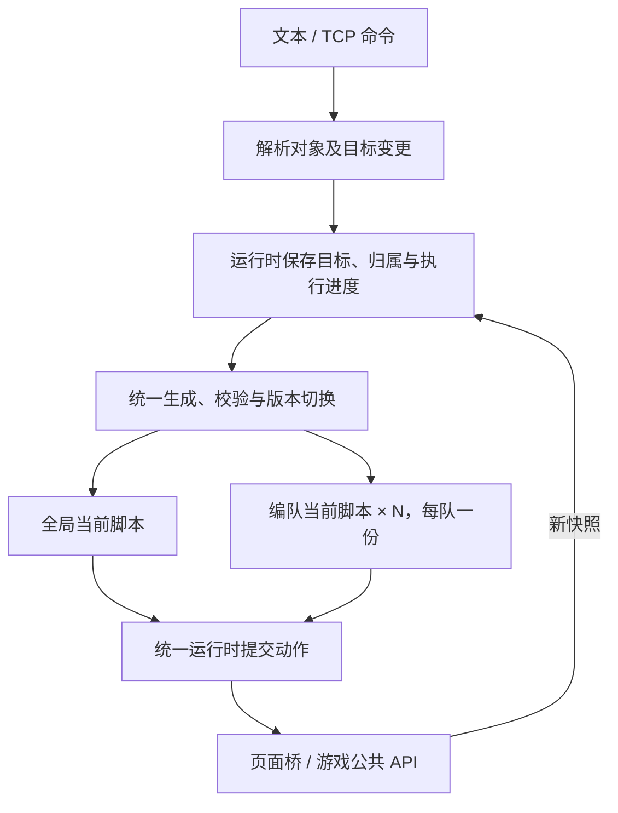

# 编队与全局脚本统一替换开发方案

状态：2026-10-21 已批准，A–D 已实施并完成本轮原型验收。

本方案基于讨论中的方向：每个编队独立运行一份脚本，其余管理工作合并为一份全局脚本，两者使用同一套生成、校验、替换和故障恢复机制。本次按批准方案实施；实际验证结果记录在文末。

## 1. 预期结果与范围

| 控制对象 | 脚本职责 | 改令影响 |
| --- | --- | --- |
| 编队，每队一份 | 本队移动、攻击、队形与任务内战术执行 | 仅替换该编队脚本 |
| 全局，每局一份 | 生产、建筑、建队、解散、转编和明确要求的补员 | 替换全局脚本，保留未取消的目标与已执行进度 |

运行中的业务脚本最多为“一份全局脚本 + 每个编队一份脚本”。空闲对象可以没有激活脚本。全局脚本不直接改写编队脚本或指挥已经交给编队的单位；编队接受玩家改令，由统一编译入口生成新版本。

复用现有 TypeScript 运行时、快照桥、QuickJS 执行器和模型接入。不为每队增加一个云 Agent 或常驻进程，仍使用现有共享执行器。脚本逻辑独立不等于执行线程并行，原有单执行器吞吐限制留到实测评估。

本轮完成文本/TCP 原型下的结构改造。语音、自然语言通用规划器、多边形地名接入、Skill 系统和规模优化仍按原路线推进。现有地域、回撤和生产规则暂沿用；本次重构不新增战略限制，也不以调整脚本归属为由扩大游戏操作能力。

## 2. 区分命令、目标和脚本

术语已同步[领域词表](../spec/CONTEXT.md)：

| 概念 | 含义 | 生命周期 |
| --- | --- | --- |
| 命令 | 玩家的一次输入，可新增、修改或取消目标 | 留作来源记录，不单独成为长期运行脚本 |
| 目标 | 需要持续完成的要求，如“造五辆坦克”或“一队守桥” | 有稳定 ID，直到完成、被替代或被取消 |
| 控制对象 | 全局或某个编队，决定当前由谁执行这些目标 | 当前对局内稳定存在 |
| 脚本版本 | 针对控制对象当前有效目标生成的完整执行代码 | 每次改令或修复整体替换 |

核心变化：旧版是“每条生产命令建立一个任务”，现改为“全局多个目标由同一份当前脚本执行”；编队任务也固定归属于编队，不再凭任意任务名建立多个控制入口。

命令记录保留原话与目标的对应关系。此处不建设事件溯源系统或通用任务工作流。

## 3. 代码替换与状态延续

运行时分开保存三类数据：

1. **目标与归属**：当前对局、控制对象、目标 ID、原命令、目标参数、成员归属和已有执行条件。
2. **执行事实**：生产提交记录、已观察到的新单位、建筑阶段、队列暂停归属、成员转换、交接记录和战损基准。
3. **脚本局部记忆**：临时选敌、站位、重试间隔等 `memory`。

前两类独立于代码版本保存，不由模型通过 `memory` 覆盖。新代码激活时局部 `memory` 清空，根据最新目标、快照和执行事实重建；同一代码版本的正常跨步执行继续保留 `memory`。

继续采用 `step(snapshot, memory) → { actions, memory }`。给快照增加当前控制对象的执行上下文，包含有效目标、动态成员和目标进度。模型可读其他己方单位用于观察，但输出动作仍按当前归属处理。编队代码从上下文读取当前成员，避免把编译时的单位 ID 写死。

编队修复、补员和转编不重置原任务的战损基准。玩家给编队换任务时，按新任务生效时的成员建立新基准。全局增加电厂目标也不会重置已有坦克目标的生产记录。

### 统一替换流程

1. 解析命令，确定受影响的控制对象与目标变更。
2. 保存待生效目标，增加该对象的目标修订号。
3. 用该对象的完整目标集合、最新快照和执行进度生成完整新脚本；旧脚本继续处理已有有效目标。
4. 复用静态校验和真实隔离干跑。干跑只产生候选结果，不修改生产记录、编队或游戏。
5. 激活前复查对局、目标修订号和相关成员归属；不匹配则丢弃候选，并用最新目标重新生成，不能静默丢失命令。
6. 原子切换代码版本和待生效目标；先前版本尚未提交的结果失效。

单纯进度推进不增加目标修订号；生成期间造好一辆坦克，不应导致反复编译。新脚本执行时读取实际最新进度，而非只依赖生成时的数字。

目标修改期间，分别保存已生效参数与待生效参数。旧脚本仍读取已生效参数，候选通过后再切换，不能因先更新了目标就让旧代码提前执行新要求。取消属于立即生效的变更。

连续收到“造坦克”“建电厂”时，全局目标集合保留两项，取消旧编译请求并针对合并后的集合重新生成。只有最新修订的结果可激活。生成失败时已有目标照常执行，新增目标显示未生效和失败原因，可重试或取消。

停止与取消立即阻止相关后续动作，不等待生成。取消全局一个目标不停止其他目标；旧脚本中指向已取消目标的动作被丢弃，随后生成剩余目标的新版本。仍有效的其他动作不因这一项取消而全部被拒绝。

## 4. 全局目标与生产进度

### 命令含义

| 命令意图 | 处理方式 |
| --- | --- |
| “再造五辆坦克”“建一座电厂” | 新增独立目标，保留已有目标 |
| “把这项坦克生产改成八辆” | 修改明确目标，保留已提交与已完成进度 |
| “这项生产先停掉” | 取消指定目标的后续执行 |
| “停止全局管理” | 暂停全局脚本并取消其待编译版本，编队继续 |
| “一队改守另一处” | 替换一队任务和脚本，其他对象继续 |

先用结构化调试入口和目标 ID 表达这些操作，避免把任意自然语言目标解析也塞进本轮。目标修改后的总量低于已提交数量时，停止继续追加并报告现状；不承诺撤销游戏已接收的订单。

### 动作必须能归属到目标

统一输出动作包装为 `{ goalId, request }`，其中 `request` 为既有游戏动作或新增编队管理动作。每个动作有明确来源，才能分别累计生产进度、取消单项目标和显示阻塞。编队脚本同样使用这一包装，保持同一套执行逻辑。

运行时按目标分别校验和记账，不能把所有目标的数量简单合成一个无来源额度。每步仍保留整体动作数量限制；因目标已取消产生的无效动作单独丢弃，格式错误或脚本异常走现有故障处理。

### 生产记录

以稳定目标 ID 保存需求总量、已预留/已提交数量、结果不确定的提交、已观察到的产物身份和建筑阶段。发送前预留，明确未发送才回退；断连等不确定结果保留记录并反馈，不通过换版本或重启自动重下。

“已提交”和“已完成”分开显示。gonghui 的车辆/步兵队列不可完整观测，不能用空队列或当前单位净增量推断订单未提交。通过首次观察到的新单位 ID 累计产物，不因已造单位阵亡重新生产。没有可靠出生事件时，同名目标先按提交顺序串行观察；无法判定来源的新单位只标记待核实，不自动补造或纳入补员。

必要前置继续复用现有闭包计算。全局编译前合并前置需求，同名已存在或正在建造的前置共用一次；显式要求额外建一座同名建筑仍是独立目标。建筑落地沿用现有自动选址与后续快照核对。

取消目标不会自动取消游戏中已投入的项目。已入队单位可能继续产出；待放置建筑若阻塞队列则明确报告，由后续命令决定处置。队列暂停记录关联来源目标，换代码不重置；取消时只按现有规则清理该目标实际暂停且仍归它管理的队列。

## 5. 编队管理与交接

全局脚本通过返回管理请求完成建队、转编和解散；运行时同步提交成员变更。它不能直接访问编队注册表或启动模型调用。新增请求仅覆盖 `createFormation`、`transferUnits`、`dissolveFormation`，在宿主处理，不发送给游戏页面。

直接的 `form` 调试命令也转成全局管理目标，使用相同入口。停止保留本地立即执行路径。

成员调整流程：

1. 全局脚本提出明确成员及去向，运行时检查目标仍有效、单位存活和源归属未改变。
2. 同步更新源队和目标队归属，并使旧归属下尚未发送的动作失效；交接单位暂时不接受任何业务脚本的新动作。
3. 运行时提交交接单位的停止订单，确认进入游戏 API 调用后开放新归属。管理请求按目标和已提交状态去重，避免换代码后重复建队或反复转编。接收队已有任务时，在下一步按原任务行动，不因补员重写任务。
4. 接收队尚无任务时单位待命。解散后单位回到未编队状态，取消该队脚本及待编译请求，沿用停止流程处理已下达订单。

建队、转编或解散涉及控制交接时，停止订单使用同局有效上下文。无法确认停止提交时保留交接状态并反馈，不先开放接收队动作，避免迟到的停止覆盖新队订单。这里确认的是 API 提交，不把它等同于观察到单位已停车。

持续补员目标由全局脚本保留，按明确来源和条件选择单位并交接。队内移动和攻击始终由接收队脚本负责；不需要把单位运到某处后再切换控制。暂未编队单位的集结由全局脚本负责；本轮只支持已有移动能力，矿车经济控制等新能力另行实现。

## 6. 文件改造范围

| 模块 | 主要改动 |
| --- | --- |
| `packages/contracts/src/` | 控制对象、目标、动作包装和编队管理请求；动态执行上下文；对应校验 |
| `packages/runtime/src/index.ts` | 任务改为按控制对象持有当前脚本；目标修订与待编译合并；统一切换和分目标动作处理 |
| `packages/runtime/src/production.ts` | 全局前置合并及生产事实记录，复用已有规则查询与闭包 |
| `packages/runtime/src/formation.ts` | 管理请求提交与控制权交接，复用唯一归属注册表 |
| `packages/runtime/src/persist.ts` | 新状态格式，保存目标、脚本和独立执行事实 |
| `packages/command/src/` | 从“单条命令生成”改为“控制对象完整目标集合生成”；更新提示词与干跑上下文 |
| `packages/js-worker/src/` | 适配动作包装和校验；保留现有隔离方式与同步入口 |
| `apps/companion/src/main.ts` | 命令分流、目标增改取消、编译合并、状态反馈与修复接入 |
| `packages/game-werhd/src/` | 继续只接收原有游戏动作；仅在交接回执确有需要时做小幅适配 |
| `tests/` 与项目文档 | 改造正常链路和少量关键故障场景，同步需求、架构和操作说明 |

运行时可把目标及进度拆入小文件，不新增独立服务、任务数据库或插件层。编译输入和动作契约同步修改，不长期维护两套脚本协议。

### 调试入口调整

- `produce` 保留语法，行为改为给全局新增目标，返回目标 ID。
- `form create/transfer/dissolve` 保留意图，改为全局目标提交；`form list` 继续直接读取状态。
- 战斗命令要求明确编队；现有 `task new <名称> @编队 ...` 可保留作过渡入口，名称作为任务标签，同一编队的新任务替换旧任务。旧的裸单位任务提示先建队。
- `task list` 展示全局与各编队的代码版本、目标、待生效变更和阻塞原因；保留 `task stop <旧标签>` 到对应编队的短期映射。
- 增加简短的 `goal list/edit/cancel` 和 `global pause/resume` 调试入口。编队改令沿用原命令入口，精确参数在对应实现阶段确定。
- 原始 `move` 等底层命令继续明确标为调试接口，不能绕过活动脚本的归属管理。用户正常流程通过编队/全局目标下令。

## 7. 持久化与故障处理

状态升级为 v3，保存当前对局、编队、目标与修订号、当前代码版本、生产事实和队列记录。内存中的切换、同一版本保存与恢复使用同一份结构，避免分别实现两种进度延续逻辑。

v2 的脚本假设单目标契约，不自动猜测合并。启动发现 v2 时保留旧文件并明确提示本轮任务需要重新下令；先核对游戏中已有队列，不能重放旧生产命令。首次保存 v3 前备份旧状态，浏览器资源与 profile 不受影响。

恢复只针对确认仍为同一对局的状态；换局后清空目标、归属和执行事实，旧脚本不能自动作用于新局。保存文件采用临时文件替换，恢复的未决提交继续保持不确定状态。

`produce` 等不能安全重放的提交，先将预留记录保存成功，再发送到页面；保存失败则不发送。重启发现只有预留、没有确认结果的记录时，按不确定提交处理。普通移动不逐条落盘，不增加独立日志数据库。

正在生成的候选不作为已激活脚本恢复。待生效目标仍保留，恢复当前对局后重新生成候选；已经开始但未确认完成的控制交接也需重新核对，不能直接开放双方发令。

编队脚本故障只暂停该编队。全局脚本故障暂停全局后续动作，已有编队继续；游戏已经接收的生产不会因此自动暂停。修复使用最新完整目标和执行事实，不重置进度。停止、暂停或新命令可以使迟到修复失效。

## 8. 开发顺序与阶段完成条件

批阅通过后按顺序推进，使用同一分支分阶段提交；阶段是交付检查点，不要求每一步重新审批。

| 阶段 | 交付内容 | 完成条件 |
| --- | --- | --- |
| A 目标与脚本分离 | 新契约、控制对象、独立执行事实、统一替换；原有停止/换局机制接入 | 一个编队完整编译执行和改令，换代码不丢保留状态，旧结果失效 |
| B 全局生产整合 | 多目标生成、合并编译、按目标生产记录与取消、前置共用、提交前保存 | 造坦克期间新增电厂，两项共存且不重复下单；连续命令不丢失 |
| C 编队管理整合 | 管理请求、动态成员、转编与持续补员；旧命令入口调整 | 建队和转编只走全局，接收队继续原任务，无两个脚本同时指挥单位 |
| D 恢复与实机验收 | v3 保存恢复、状态列表、修复流程、文档和关键实机记录 | 两队与全局同时工作，能停止、改令、补员、修复并从同局恢复 |

阶段 A–C 同步适配相应测试和调试入口，避免最后再补接口。阶段 B 接入 v3 保存，阶段 D 才启用新格式自动恢复；此前不从 v2 恢复旧协议任务。小步提交可用于回退定位，不发布新旧架构并行运行的功能开关。回退旧代码时保留 v3 文件但不加载它；原型任务重新下令，不尝试反向转换状态。

需求、架构、领域词表、README 和 AGENTS.md 同步更新；[ADR 006](../decisions/006-script-per-control-owner.md) 替代 ADR 004 中“每命令独立任务”的部分，保留其跨局 Skill 与状态隔离原则。

## 9. 验收方式

延续原型阶段的轻量测试策略，不恢复大批策略矩阵。优先改造已有测试，少量补充本次结构变更直接引入的风险。

| 场景 | 自动化重点 | 实际游戏重点 |
| --- | --- | --- |
| 两个编队与全局同时运行 | 一个对象改令不替换其他对象代码 | 云端编译时其余对象继续工作 |
| 已提交三辆坦克后新增电厂目标 | 保留三辆提交记录，只追加剩余需求，电厂目标仍在 | 实际产出、建筑落地和目标进度一致 |
| 全局连续新增两项目标、取消其中一项 | 最新候选包含全部未取消目标；旧候选和取消项不能生效 | 取消后没有新追加，已入队项目状态显示清楚 |
| 转编与执行同时发生 | 旧归属结果失效，重复管理请求不重复变更 | 停车交接、接收队行动和无任务待命 |
| 全局脚本异常后修复或同局恢复 | 生产记录与归属不丢失，不重复下单 | 编队继续，恢复后观察队列及实际产物 |

自动化使用固定模型响应、合成快照与现有真实隔离执行器；不依赖云端或真实游戏启动。运行 `pnpm typecheck`、`pnpm test`、`pnpm maps:check` 和差异格式检查。地图检查用于确认本轮契约变更未破坏现有能力，不扩充地图测试范围。

实机先用两队少量坦克与两项全局目标，在冰天雪地记录版本、MOD、命令、切换和结果。不把这次结构验收扩成 100 单位/8 编队性能项目；达到可操作原型后再推进既有规模目标。

## 10. 批阅重点

本方案建议一并确认以下默认选择，后续按此实施：

1. 每队一份脚本，全局一份脚本，共用整套执行与替换机制。
2. 全局新命令默认增加目标；明确修改、取消才改变已有目标；换代码保留执行事实。
3. 建队、转编、补员由全局脚本提出，运行时落实唯一归属；编队只负责本队战术行动。
4. 本轮先完成文本/TCP 原型，旧 v2 任务重新下令，语音和地名接入另行推进。

## 实施与验证记录（2026-10-21）

已完成统一脚本契约、完整目标编译、生产预留保存、动态成员交接、持续补员与未编队集结、v3 同局恢复和旧状态备份。调试入口增加按单位 ID 建队，以及人工核对不确定提交后的 `goal resolve <提交ID> sent|not-sent`。

自动化共 29 项通过，其中本轮新增 6 个关键场景，覆盖真实 QuickJS 下两队与全局接线、合并编译、单目标取消、转编失败重试，以及生产预留保存与未决恢复；实机发现的 PROC 前置、未解锁生产与单格建筑队列另有针对性检查，未增加策略组合矩阵。

实机环境：本地游戏快照 `7f6858a`、强制 MOD `gonghui`、冰天雪地 200×200、French，默认模型 DeepSeek `deepseek-flash`。初始展开基地车作为测试准备，后续建设、生产、建队与调动均通过伴随程序目标和公开 API 执行。未使用私有引擎对象。

| 实机场景 | 观察结果 |
| --- | --- |
| 制造四辆坦克的前置链 | 电厂→矿场/兵营→重工均实际落地，四辆 MTNK 累计产出确认完成 |
| 生产期间新增一座电厂 | 新目标独立完成，原坦克目标及既有前置进度保留 |
| 两条建队命令连续提交 | 同一全局版本保留两项目标，各建两辆坦克的编队，成员唯一归属 |
| 两队移动与单队改令 | 两队均观察到原生位移；一队 v1→v2，二队保持 v1；本次仅核对位移，指定终点补验见下文 |
| 已有四辆坦克再新增一辆 | 按新目标实际生产第五辆，未把既有同名单位当作新目标完成 |
| 持续补员与明确转编 | 第五辆加入一队，队内脚本未重编译，任务原始基准仍为两辆；随后二队一辆完成停车交接并转入一队 |
| 退出并重启伴随程序 | 同一对局 UUID 下恢复全局 v9、一队 v2、二队 v1，最终成员为四辆/一辆；生产记录数保持一致，无新增下单 |

本轮实机发现并修复了三类接入问题：未解锁时的 PROC 阵营前置解析、生成脚本读取的能力字段与实际快照位置不一致、单格建筑队列被同批次不同项目争用。增加原生可造清单、队列空位和未落地提交的检查，提示词明确剩余额度已扣减、显式新增目标不能被既有同名建筑抵消。早期未真正入队的兵营提交经公开队列与场上建筑核对后，用 `goal resolve ... not-sent` 释放，再继续原目标。

本地诊断保存在 `.runtime/refactor-verification.json` 和 `.runtime/shots/refactor-verified.png`，不纳入版本库。自动化隔离、故障恢复通过；本轮实机以建设、生产和调动为主，没有重新测量攻击效果、战损条件、规模性能或地图分区边界，不替代后续里程碑验证。

### 指定终点与停止补验（2026-10-21）

继续检查发现，一队 v2 将“移动到60,128”错误生成为前往授权矩形中心58,123。此前发生位移的结果不足以证明执行符合指令。修正生成提示，明确 rawText 中的目的地、行动顺序和停止条件必须落实，region 仅表示活动边界；到达须观察全部存活成员的位置，并考虑成员变化和未到达时已空闲的重试。

同一真实对局、同一模型通过以下补验，诊断保存在 `.runtime/destination-verification.json`：

| 场景 | 观察结果 |
| --- | --- |
| 重下60,128的移动指令 | 四辆坦克均到达目的地周围相邻格并空闲，没有停在区域中心 |
| 两队并行指定不同终点 | 一队四辆到达55,132，二队一辆到达55,115，各自仅更新本队版本，全局版本不变 |
| 编译期间停止一队 | 停止后迟到结果未激活新版本，部队保持在原终点 |
| 一队原生移动中停止 | 四辆均停车，随后位置保持稳定，二队仍保持原任务 |

`pnpm typecheck` 与既有29项测试通过；本次未扩充自动化策略用例。上述结果验证了这些指令的实际效果，攻击、战损回撤与大规模性能仍未补验。
